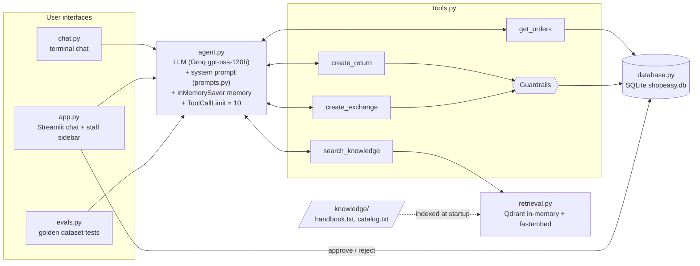
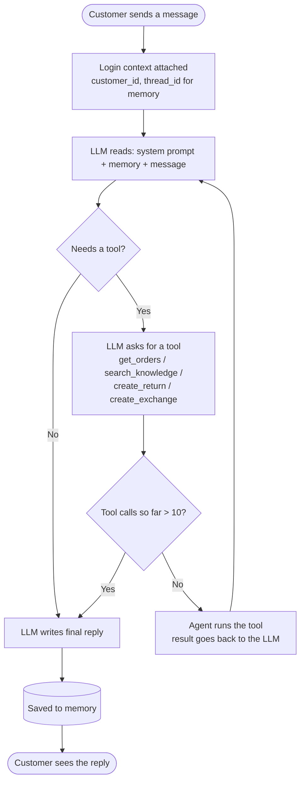
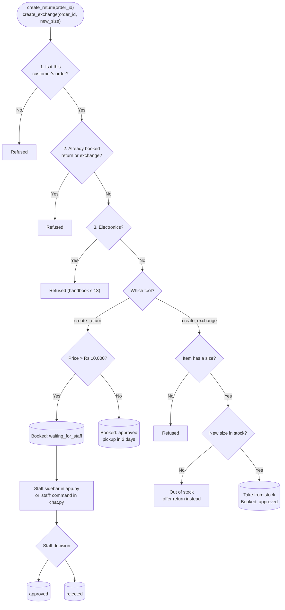
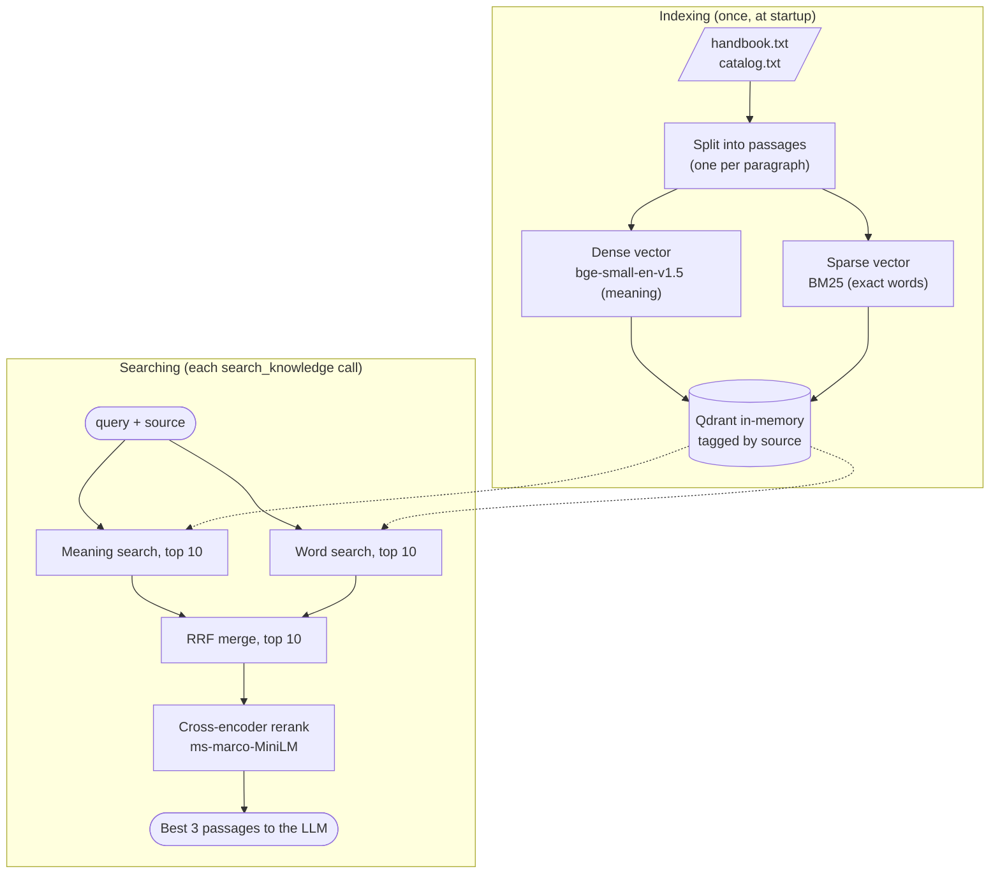
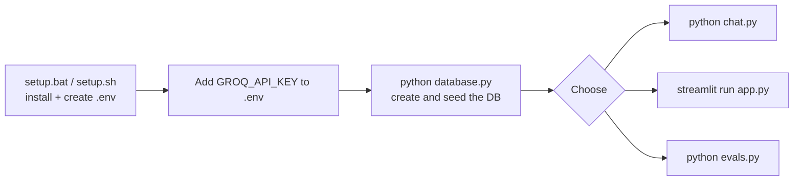

# ShopEasy Returns Agent

An AI agent that handles returns and exchanges for an online store. It reads orders from a database, searches a policy handbook (RAG), decides, and books returns. Guardrails in code and a staff approval step keep it safe.

**Agent = LLM + Tools + Memory + Loop**

> Diagrams below use Mermaid. In VS Code, install the extension **Markdown Preview Mermaid Support** (`bierner.markdown-mermaid`), then press `Ctrl+Shift+V` to preview this file.

## 1. System overview

## 2. One message through the agent (the loop)

## 3. Guardrails: create_return / create_exchange

The LLM decides from the handbook. These checks run in code, so the LLM cannot get around them.

## 4. Retrieval (RAG) in retrieval.py

## 5. Run order

## Files

| File | Role |
|---|---|
| `database.py` | Customers, orders, returns, stock (SQLite) |
| `retrieval.py` | Hybrid search + rerank over handbook and catalog |
| `tools.py` | The 4 tools and the guardrails |
| `prompts.py` | System prompt versions |
| `agent.py` | Builds the agent: LLM + tools + memory + loop limit |
| `chat.py` | Terminal chat |
| `app.py` | Streamlit chat with staff approvals |
| `evals.py` | Runs the agent on `golden_dataset.csv` |
| `flow.html`, `architecture.html` | Interactive versions of these diagrams (open in a browser) |

See [LAB.md](LAB.md) for the step-by-step lab.
